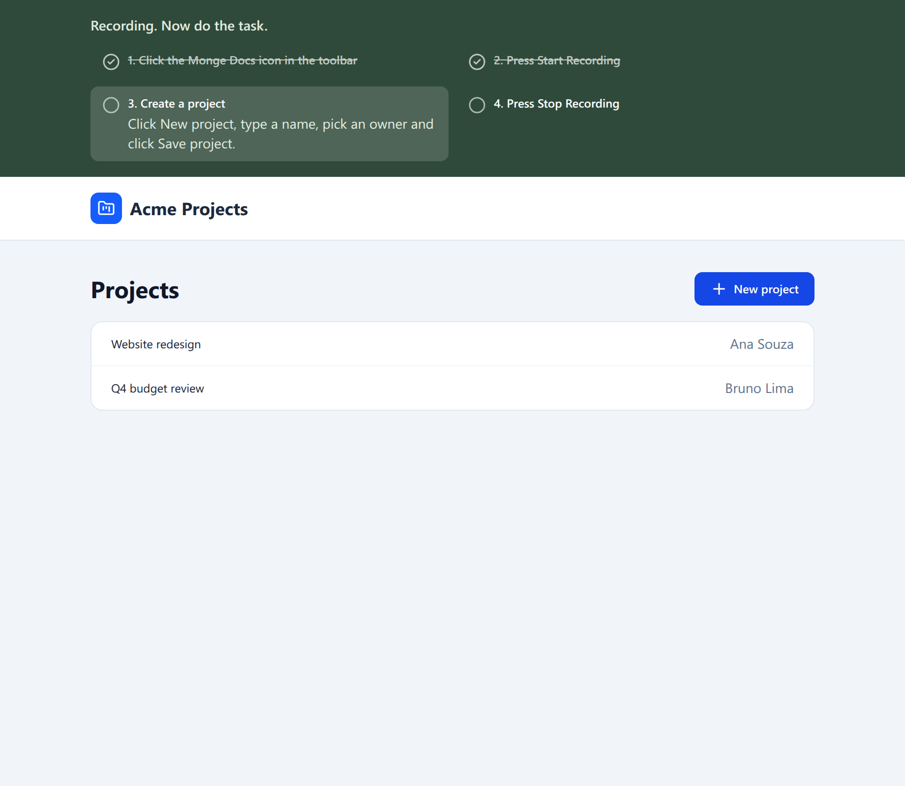
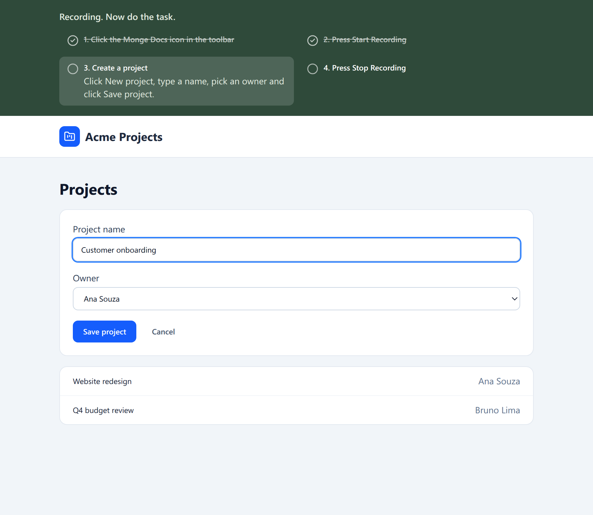
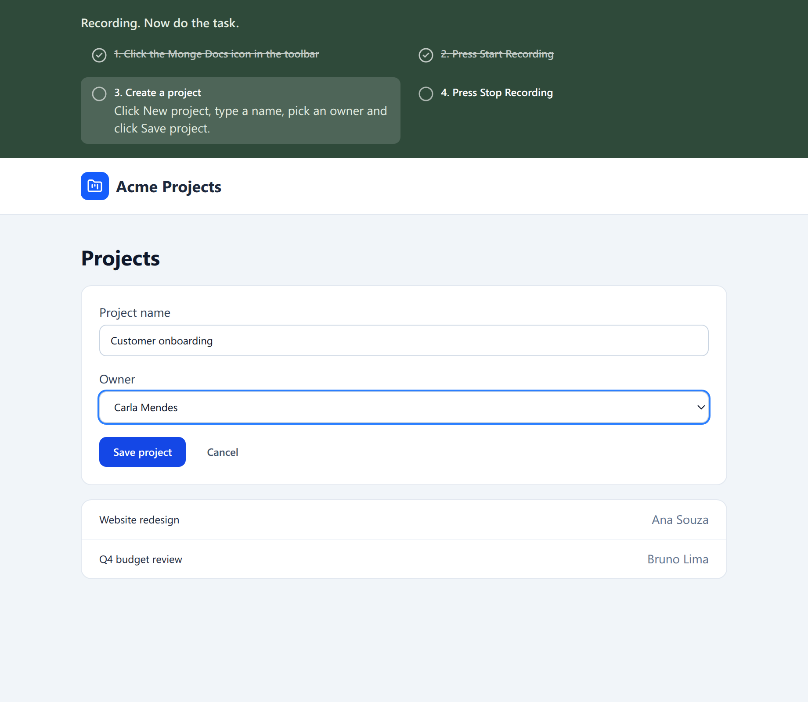

## 📋 Overview

This guide shows you how to create a new project in **Acme Projects**. You will open the new project form, give the project a name, choose who owns it and save it.

**What you will do:**

- Open the **New project** form from the Projects page
- Enter a project name
- Choose the project owner
- Save the project

> **Requirements:** You need access to Acme Projects and must be on the **Projects** page.

---

## 🚀 Step-by-Step Guide

### Step 1: Click New project

On the **Projects** page, click the blue **New project** button with the plus sign. It is on the right, level with the **Projects** heading and above the list of projects.

---

### Step 2: Enter the project name

A form opens with the **Project name** field at the top. Click the field and type the name of your project. In this example, the name is **Customer onboarding**.

---

### Step 3: Choose the owner

Open the **Owner** dropdown, just below the project name, and select the person responsible for the project. The dropdown starts on Ana Souza; in this example, the owner chosen is **Carla Mendes**.

---

### Step 4: Save the project

Check the name and the owner, then click the blue **Save project** button at the bottom left of the form, next to **Cancel**.

---

## ✅ Result

You have created the **Customer onboarding** project with **Carla Mendes** as its owner. It is saved in Acme Projects and should now appear on the **Projects** page, together with your other projects.

---

## 💡 Tips

- **Use a clear name.** A name that describes the work, such as *Customer onboarding*, makes the project easy to find in the list.
- **Check the owner before saving.** The **Owner** dropdown already has a person selected when the form opens (Ana Souza in this example), so change it if someone else is responsible.
- **Changed your mind?** The **Cancel** button is right next to **Save project**.

---

## ❓ FAQ

**Where is the New project button?**

On the **Projects** page, on the right side, level with the **Projects** heading.

**Do I have to choose an owner?**

The form opens with an owner already selected, so check that it is the right person before you save.

**Can I back out without creating the project?**

Yes. Instead of **Save project**, click **Cancel**, the button next to it.