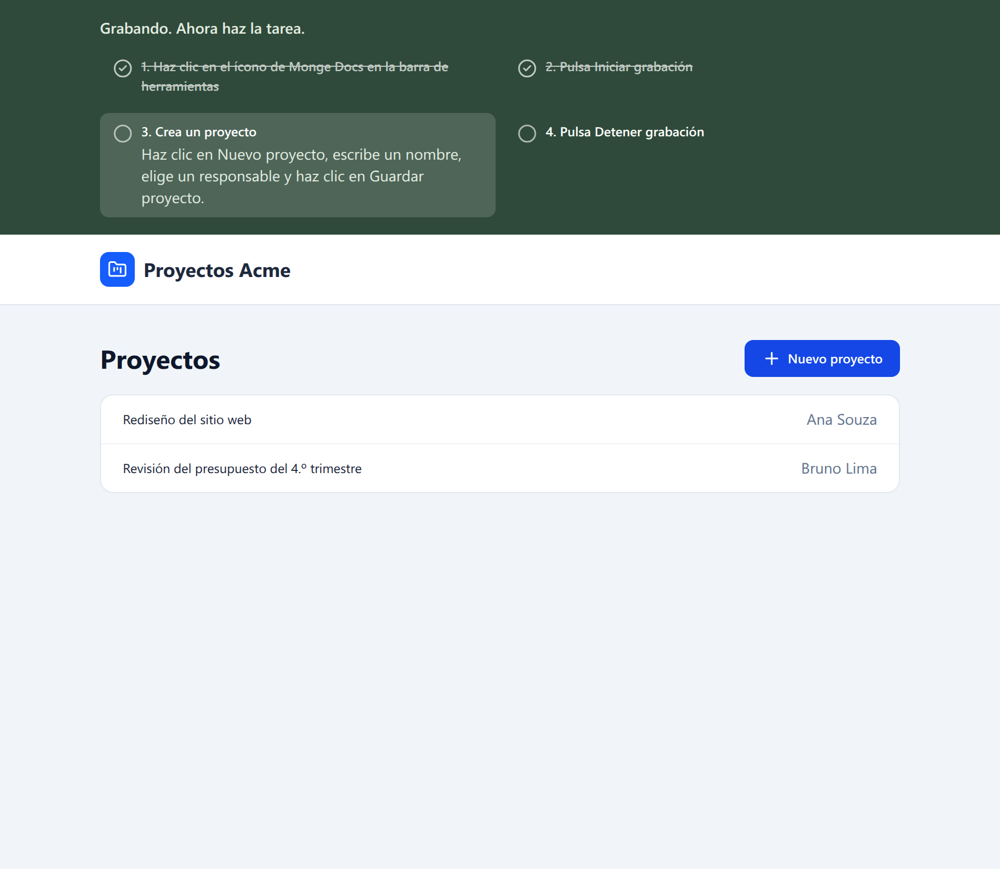
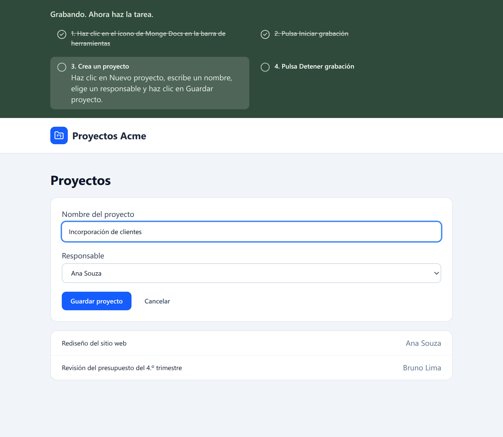
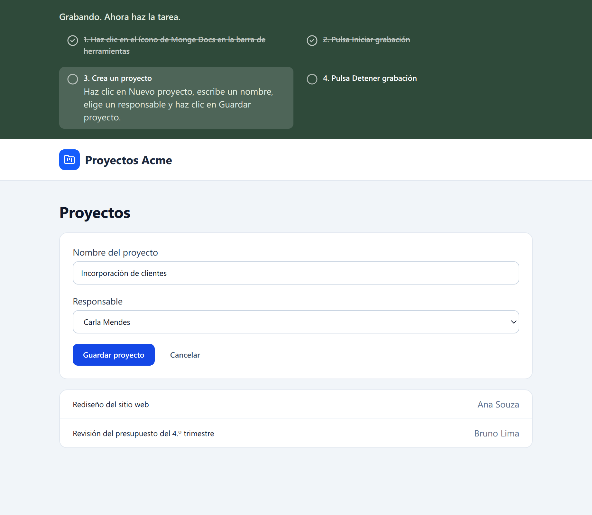

## 📋 Descripción general

Esta guía muestra cómo crear un nuevo proyecto en **Proyectos Acme**. Abrirás el formulario de nuevo proyecto, le pondrás un nombre al proyecto, elegirás a su responsable y lo guardarás.

**Qué vas a hacer:**

- Abrir el formulario **Nuevo proyecto** desde la página Proyectos
- Escribir el nombre del proyecto
- Elegir al responsable del proyecto
- Guardar el proyecto

> **Requisitos:** necesitas acceso a Proyectos Acme y estar en la página **Proyectos**.

---

## 🚀 Guía paso a paso

### Paso 1: Haz clic en Nuevo proyecto

En la página **Proyectos**, haz clic en el botón azul **Nuevo proyecto**, el del signo más. Está a la derecha, a la altura del título **Proyectos** y encima de la lista de proyectos.

---

### Paso 2: Escribe el nombre del proyecto

Se abre un formulario con el campo **Nombre del proyecto** en la parte superior. Haz clic en el campo y escribe el nombre de tu proyecto. En este ejemplo, el nombre es **Incorporación de clientes**.

---

### Paso 3: Elige al responsable

Abre la lista **Responsable**, justo debajo del nombre del proyecto, y selecciona a la persona que se encargará del proyecto. La lista empieza en Ana Souza; en este ejemplo, la persona elegida es **Carla Mendes**.

---

### Paso 4: Guarda el proyecto

Revisa el nombre y el responsable y haz clic en el botón azul **Guardar proyecto**, en la parte inferior izquierda del formulario, junto a **Cancelar**.

---

## ✅ Resultado

Has creado el proyecto **Incorporación de clientes**, con **Carla Mendes** como responsable. Queda guardado en Proyectos Acme y debería aparecer en la página **Proyectos**, junto con los demás proyectos.

---

## 💡 Consejos

- **Usa un nombre claro.** Un nombre que describa el trabajo, como *Incorporación de clientes*, ayuda a encontrar el proyecto en la lista.
- **Revisa el responsable antes de guardar.** La lista **Responsable** ya tiene a una persona seleccionada cuando se abre el formulario (Ana Souza en este ejemplo); cámbiala si otra persona se encargará del proyecto.
- **¿Has cambiado de idea?** El botón **Cancelar** está justo al lado de **Guardar proyecto**.

---

## ❓ Preguntas frecuentes

**¿Dónde está el botón Nuevo proyecto?**

En la página **Proyectos**, a la derecha, a la altura del título **Proyectos**.

**¿Tengo que elegir un responsable?**

El formulario se abre con un responsable ya seleccionado; comprueba que sea la persona correcta antes de guardar.

**¿Puedo salir sin crear el proyecto?**

Sí. En lugar de **Guardar proyecto**, haz clic en **Cancelar**, el botón de al lado.