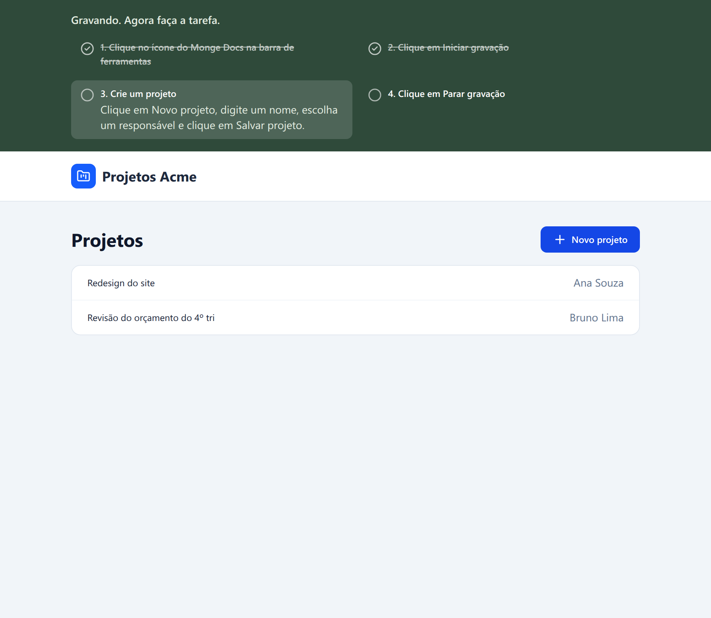
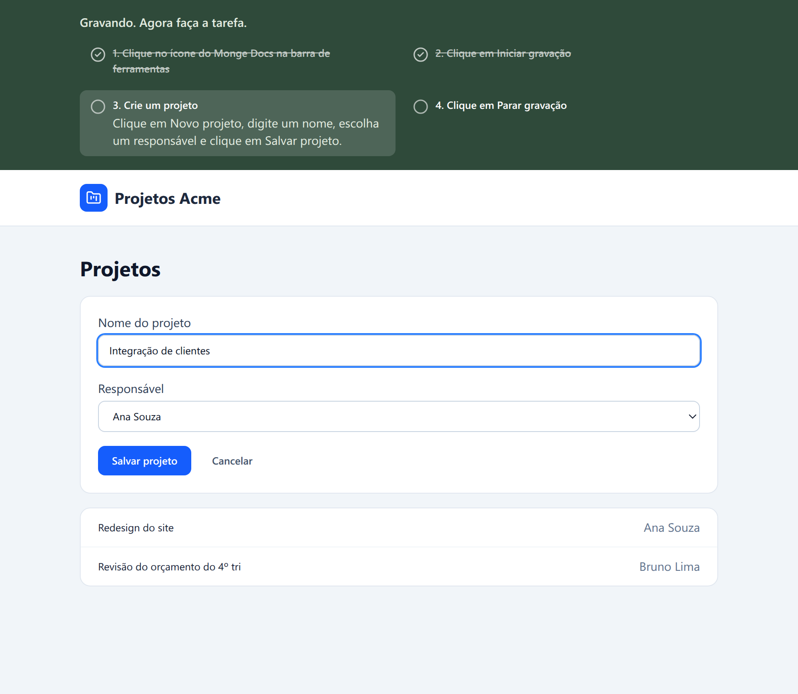
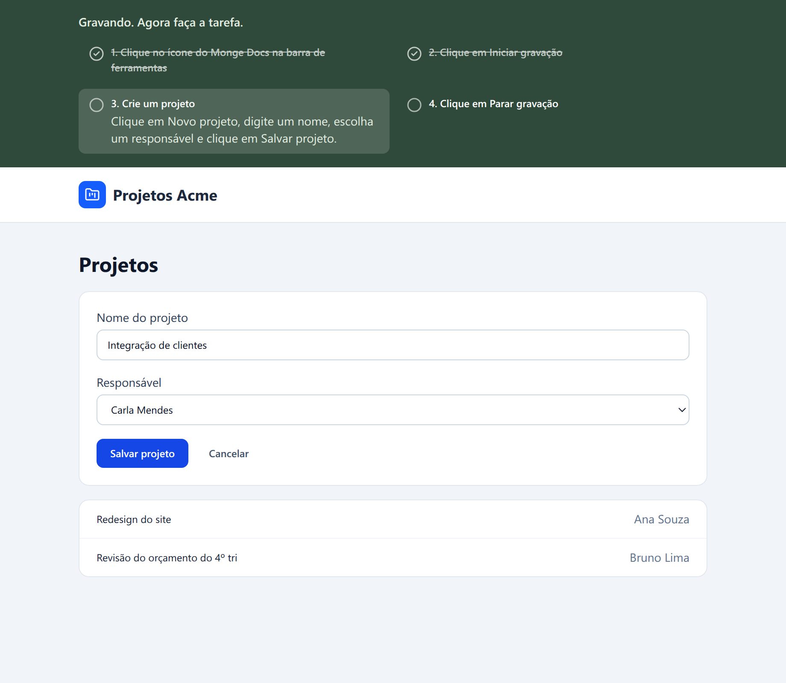

## 📋 Visão geral

Este guia mostra como criar um novo projeto no **Projetos Acme**. Você vai abrir o formulário de novo projeto, dar um nome ao projeto, escolher o responsável e salvar.

**O que você vai fazer:**

- Abrir o formulário **Novo projeto** na página Projetos
- Informar o nome do projeto
- Escolher o responsável pelo projeto
- Salvar o projeto

> **Requisitos:** você precisa ter acesso ao Projetos Acme e estar na página **Projetos**.

---

## 🚀 Passo a passo

### Passo 1: Clique em Novo projeto

Na página **Projetos**, clique no botão azul **Novo projeto**, com o sinal de mais. Ele fica à direita, na altura do título **Projetos** e acima da lista de projetos.

---

### Passo 2: Digite o nome do projeto

O formulário abre com o campo **Nome do projeto** no topo. Clique no campo e digite o nome do seu projeto. Neste exemplo, o nome é **Integração de clientes**.

---

### Passo 3: Escolha o responsável

Abra a lista **Responsável**, logo abaixo do nome do projeto, e selecione a pessoa que vai cuidar do projeto. A lista começa em Ana Souza; neste exemplo, a pessoa escolhida é **Carla Mendes**.

---

### Passo 4: Salve o projeto

Confira o nome e o responsável e clique no botão azul **Salvar projeto**, no canto inferior esquerdo do formulário, ao lado de **Cancelar**.

---

## ✅ Resultado

Você criou o projeto **Integração de clientes**, com **Carla Mendes** como responsável. Ele fica salvo no Projetos Acme e deve aparecer na página **Projetos**, junto com os outros projetos.

---

## 💡 Dicas

- **Use um nome claro.** Um nome que descreve o trabalho, como *Integração de clientes*, facilita encontrar o projeto na lista.
- **Confira o responsável antes de salvar.** A lista **Responsável** já vem com uma pessoa selecionada quando o formulário abre (Ana Souza, neste exemplo); troque se outra pessoa for cuidar do projeto.
- **Mudou de ideia?** O botão **Cancelar** fica bem ao lado de **Salvar projeto**.

---

## ❓ Perguntas frequentes

**Onde fica o botão Novo projeto?**

Na página **Projetos**, do lado direito, na altura do título **Projetos**.

**Preciso escolher um responsável?**

O formulário já abre com um responsável selecionado; confira se é a pessoa certa antes de salvar.

**Posso desistir sem criar o projeto?**

Sim. Em vez de **Salvar projeto**, clique em **Cancelar**, o botão ao lado.